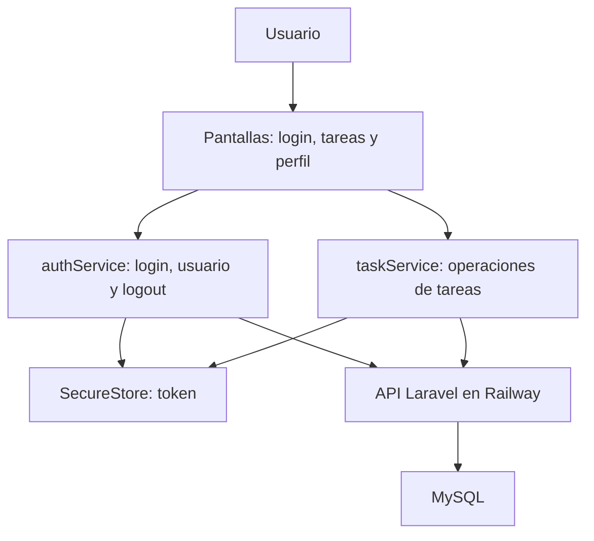

# Organización y funcionamiento del proyecto

## Cómo funciona

La aplicación tiene tres partes principales:

- El frontend muestra las pantallas y recibe las acciones del usuario.
- La API Laravel valida las solicitudes y administra los datos.
- MySQL guarda usuarios, tareas y tokens de acceso.

El login, el perfil y las operaciones de tareas están conectados
con Laravel. El backend está alojado en Railway y se consulta
mediante HTTPS.

## Diagrama general

Las pantallas llaman a los servicios. Los servicios envían
solicitudes a Laravel y transforman las respuestas para mostrarlas.

## Carpetas principales

- app/: pantallas y navegación.
- src/components/: tarjetas y filtros de estado.
- src/services/: comunicación con la API y almacenamiento del token.
- src/types/: tipos de datos de TypeScript.
- src/utils/: filtros y validaciones.
- __tests__/: pruebas automatizadas.
- assets/: recursos gráficos.
- docs/: documentación y evidencias.

## Pantallas y componentes

| Archivo | Qué hace |
|---|---|
| app/index.tsx | Abre el login al iniciar |
| app/_layout.tsx | Define la navegación general |
| app/login.tsx | Muestra el formulario de acceso |
| app/tasks.tsx | Coordina el listado y las operaciones de tareas |
| app/profile.tsx | Muestra nombre, correo y cierre de sesión |
| src/components/TaskCard.tsx | Presenta cada tarea y sus acciones |
| src/components/StatusTabs.tsx | Permite filtrar por estado |

Al tocar el nombre del usuario en el gestor se abre Mi perfil.
La creación está en el tablero y la edición se abre en un modal.

## Servicios, tipos y utilidades

| Archivo | Qué hace |
|---|---|
| src/services/authService.ts | Login, consulta del usuario y logout |
| src/services/sessionStorage.ts | Guarda, recupera y elimina el token |
| src/services/config.ts | Lee la dirección de la API |
| src/services/taskService.ts | Lista, crea, edita, completa y elimina tareas |
| src/types/task.ts | Define los datos de una tarea |
| src/utils/taskFilters.ts | Filtra por búsqueda y estado |
| src/utils/taskValidation.ts | Rechaza títulos vacíos o de solo espacios |

El servicio de tareas ya no utiliza un listado simulado.
Conserva una opción para simular un error durante las pruebas.

## Archivos de configuración

- .env: dirección de la API utilizada durante el desarrollo local.
- .env.example: ejemplo de configuración, sin credenciales.
- app.json: configuración general, nombre, ícono e identificador.
- app.config.js: adapta nombre, scheme e identificador para Development.
- eas.json: perfiles de compilación y dirección de la API.
- package.json: dependencias y comandos disponibles.
- package-lock.json: versiones resueltas de las dependencias.

EXPO_PUBLIC_API_URL contiene una dirección pública.
No debe contener contraseñas ni tokens.

## Flujo del login

1. El usuario ingresa correo y contraseña.
2. app/login.tsx llama a login en authService.ts.
3. El servicio envía POST /api/login.
4. Laravel comprueba las credenciales.
5. Si son correctas, devuelve un token y los datos del usuario.
6. sessionStorage.ts guarda el token en SecureStore.
7. Se abre el gestor y se verifica la sesión con GET /api/user.
8. Se consultan las tareas del usuario.

La aplicación no guarda la contraseña.
Laravel guarda su hash, no la contraseña en texto plano.

## Sesión y cierre de sesión

Las solicitudes protegidas envían el token como Bearer Token.

Antes de mostrar el gestor o el perfil se verifica la sesión.
Si Laravel rechaza el token con 401, se elimina el token local
y se vuelve al login.

Al cerrar sesión se solicita a Laravel revocar el token actual.
Después se elimina del celular y se vuelve al login.

Una falla de conexión no se interpreta como contraseña incorrecta
ni como sesión vencida. Al verificar la sesión se permite reintentar.

## Recorrido de una operación de tareas

Ejemplo: editar una tarea.

1. TaskCard muestra el botón Editar tarea.
2. app/tasks.tsx abre el formulario con los datos actuales.
3. Al guardar, llama a updateTask en taskService.ts.
4. El servicio envía PATCH /api/tasks/{id} con el token.
5. Laravel busca la tarea dentro de las del usuario autenticado.
6. Valida los datos y guarda los cambios en MySQL.
7. Devuelve la tarea actualizada.
8. El servicio adapta la respuesta y la pantalla actualiza el listado.

La misma separación se utiliza para crear, listar,
cambiar el estado y eliminar.

## Datos de una tarea

- Título y descripción.
- Prioridad: baja, media o alta.
- Estado: pendiente o completada.
- Categoría, notas y vencimiento, opcionales.
- Slug generado automáticamente.
- Fecha de finalización administrada por Laravel.

El vencimiento se envía como AAAA-MM-DD.
La fecha de finalización se registra al completar y se limpia
al volver a pendiente.

Las tareas históricas ya completadas pueden no tener una fecha
de finalización, porque no se inventó ese dato al migrar.

## Backend: archivos principales

El backend se encuentra en un repositorio separado.

- routes/api.php: rutas y protección con Sanctum.
- app/Http/Controllers/Api/AuthController.php:
  verifica credenciales, genera tokens y cierra sesión.
- app/Http/Controllers/Api/TaskController.php:
  valida y procesa las operaciones de tareas.
- app/Models/User.php: usuario y relación con sus tareas.
- app/Models/Task.php: datos de tarea, relaciones,
  borrado lógico y campos automáticos.
- database/migrations/: estructura y cambios de las tablas.

## Rutas de la API

| Método | Ruta | Función |
|---|---|---|
| POST | /api/login | Iniciar sesión |
| POST | /api/logout | Cerrar sesión |
| GET | /api/user | Consultar usuario autenticado |
| GET | /api/tasks | Listar tareas propias |
| POST | /api/tasks | Crear una tarea |
| PATCH | /api/tasks/{id} | Editar datos o cambiar estado |
| DELETE | /api/tasks/{id} | Borrado lógico |

Solamente login permite acceso sin token previo.

Laravel determina el propietario por la sesión.
El cliente no puede elegir otro user_id.
Las tareas ajenas no se pueden editar ni eliminar.

El borrado lógico completa deleted_at.
El registro se conserva y deja de aparecer en el listado normal.

## Development y Preview

Development incluye expo-dev-client y carga el código desde Metro.
Se utiliza para programar y probar cambios.

Preview lleva el código incorporado y se abre sin Metro,
Expo Go ni computadora. Necesita internet para acceder a Railway.

Las variantes tienen identificadores Android distintos,
por lo que pueden instalarse juntas.

## Pruebas y documentación

Jest comprueba filtros, validaciones y el componente TaskCard.
Las pruebas de Laravel verifican autenticación, permisos,
operaciones de tareas y los campos agregados.

Los recorridos completos también se prueban manualmente.
Los resultados y capturas están en docs/testeo.

El detalle de los seis errores originales se encuentra
en INFORME_INCIDENTES.md.

## Verificación final

La Preview actualizada se instaló y se comprobó el recorrido
completo de login, perfil, sesión y ABM con los campos nuevos,
sin depender de los servidores locales.