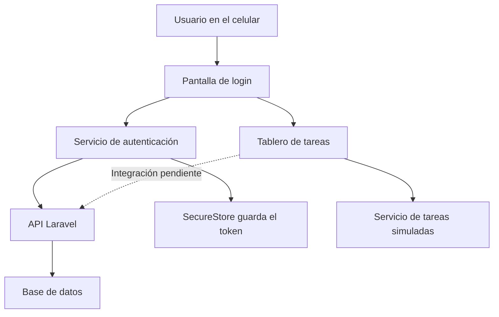

# Organización del proyecto

## Cómo funciona

El proyecto tiene dos partes:

- El frontend es la aplicación que se abre en el celular.
- El backend Laravel recibe las solicitudes, valida los datos y trabaja con la base de datos.

El login del celular ya se conecta al backend. Las operaciones del tablero todavía usan datos simulados y están pendientes de integración.

## Diagrama del estado actual

## Carpetas principales

- app: pantallas y navegación.
- src/components: tarjetas y otros componentes reutilizables.
- src/services: comunicación con el backend, configuración, almacenamiento del token y servicio simulado de tareas.
- src/types: tipos de datos de TypeScript.
- src/utils: filtros y validaciones.
- __tests__: pruebas automatizadas.
- docs: documentación y evidencias.

## Archivos importantes

- app/index.tsx: abre la ruta del login.
- app/login.tsx: formulario y mensajes del inicio de sesión.
- app/tasks.tsx: tablero del gestor.
- app/_layout.tsx: navegación entre pantallas.
- src/services/authService.ts: envía las credenciales y comprueba la respuesta.
- src/services/sessionStorage.ts: guarda, recupera y elimina el token.
- src/services/config.ts: obtiene la dirección del backend.
- src/services/taskService.ts: servicio simulado que usa actualmente el tablero.

## Flujo del login

1. El usuario escribe correo y contraseña.
2. La pantalla llama al servicio de autenticación.
3. El servicio envía los datos al backend.
4. Laravel verifica las credenciales.
5. Si son correctas, devuelve un token.
6. El frontend guarda el token en SecureStore y abre el gestor.
7. Si hay un error, muestra un aviso y permanece en el login.

La contraseña no se guarda en el celular.

## Rutas del backend

Estas rutas ya existen en Laravel:

| Método | Ruta | Función |
|---|---|---|
| POST | /api/login | Iniciar sesión |
| POST | /api/logout | Cerrar sesión |
| GET | /api/user | Consultar al usuario autenticado |
| GET | /api/tasks | Listar las tareas propias |
| POST | /api/tasks | Crear una tarea |
| PATCH | /api/tasks/{id} | Editar datos o cambiar el estado |
| DELETE | /api/tasks/{id} | Eliminar una tarea mediante borrado lógico |

El login no necesita token previo. Las demás rutas requieren un token Bearer vigente.

El backend toma al propietario del usuario autenticado. No permite elegir otro propietario al crear una tarea ni modificar tareas ajenas.

Actualmente el frontend solo consume la ruta de login. La conexión de las demás operaciones está pendiente.

## Pendientes

- Proteger el acceso a las pantallas.
- Incorporar cierre de sesión y manejo de sesión vencida.
- Conectar el tablero con las tareas reales.
- Generar y probar la APK de preview.